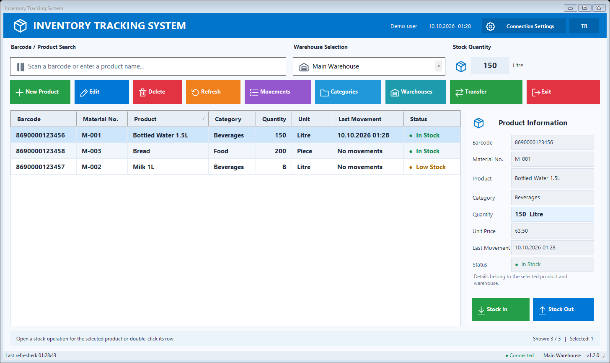
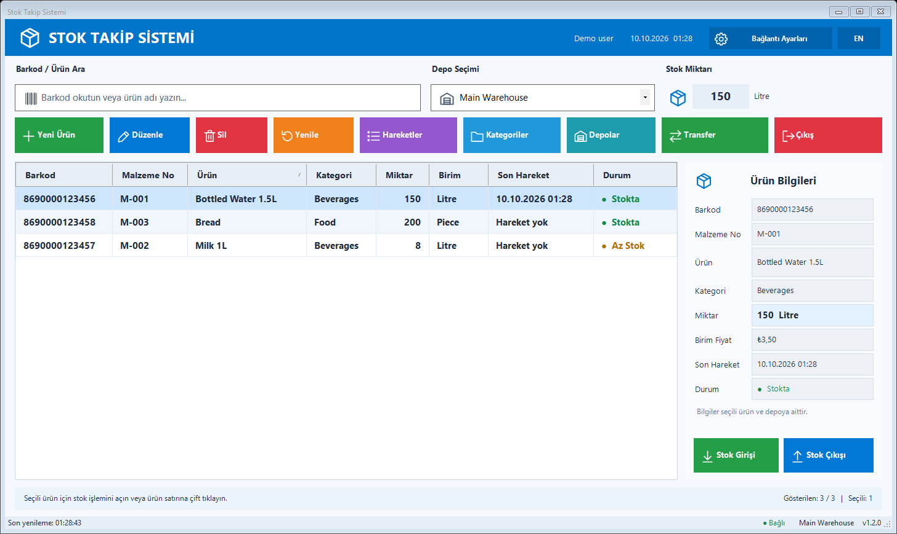
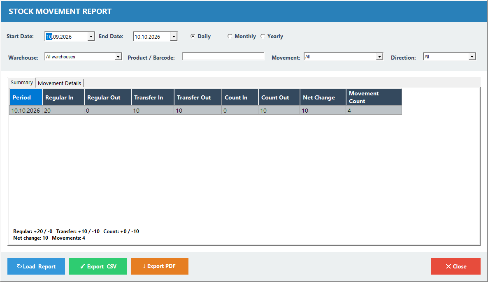
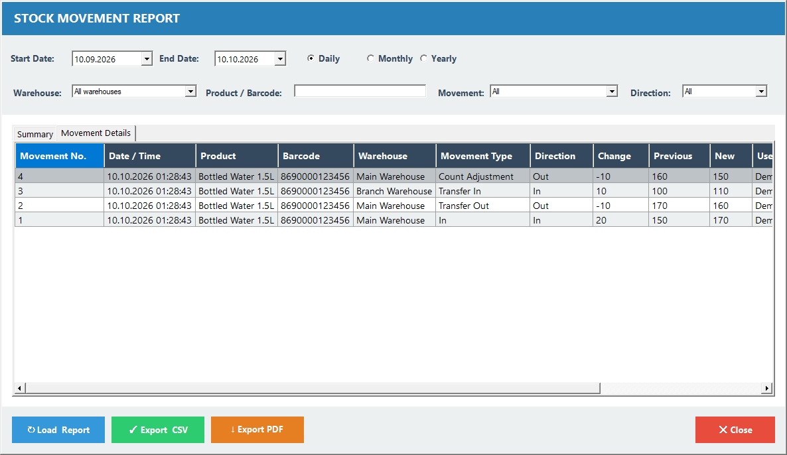
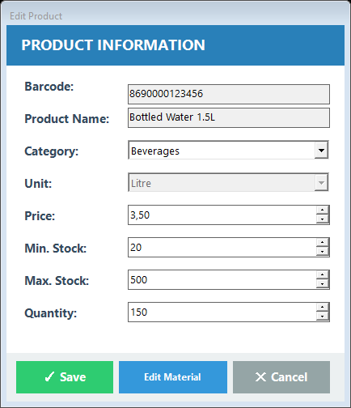
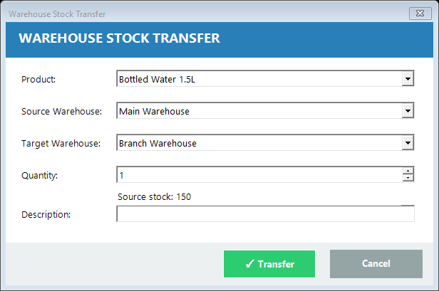

# InventoryTracking

A Windows Forms inventory management application built with C# and SQL Server, with a switchable Turkish and English interface.

This personal project follows the development of an inventory application through several versions: product and stock management, warehouse transfers, movement reports, reusable interface controls and localization.

## Features

- Material catalog with material numbers, barcodes, descriptions and units.
- Product management with categories, prices and stock limits.
- Stock tracking by warehouse, including entries, withdrawals and count adjustments.
- Transfers between warehouses with movement history.
- Movement reports filtered by date, warehouse, product/barcode, movement type and direction.
- CSV export and PDF reports using Windows **Microsoft Print to PDF**. Saved PDFs can be printed from a PDF viewer.
- Database connection setup from the application.
- One-click **TR/EN** switching with a saved language preference.

## Screenshots

Screenshots use an isolated demo database and a demo user label.

### English main window



### Turkish main window



### Stock movement report





<details>
<summary>Product and warehouse transfer screens</summary>





</details>

## Technologies

- C# and .NET Framework 4.8.1
- Windows Forms
- Microsoft SQL Server
- ADO.NET / System.Data.SqlClient
- `.resx` resources and ResourceManager

The application and localization checks use framework libraries and require no NuGet packages.

## Requirements

- Windows and .NET Framework 4.8.1.
- Visual Studio with the .NET desktop development workload and .NET Framework 4.8.1 targeting support.
- An accessible SQL Server instance.
- SQL Server Management Studio for database setup.
- Microsoft Print to PDF enabled for PDF export.

## Getting started

1. Clone or download the repository.
2. Copy `InventoryTracking/App.config.example` to `InventoryTracking/App.config`.
3. For a fresh demo installation, open `InventoryTracking/Notes/SqlDataBaseScriptV1.txt` in SQL Server Management Studio and execute it against your development SQL Server instance. It creates the `InventoryTracking` database, its schema and sample records.
4. Open `InventoryTracking.slnx` in Visual Studio. Alternatively, open `InventoryTracking/InventoryTracking.csproj` directly.
5. Build and run the application.
6. Configure the SQL Server connection for the `InventoryTracking` database. If the initial connection fails, the connection setup window opens. The main window also has a **Connection Settings** button.
7. Click **EN** or **TR** at the top right to change language.

**Database setup:** The demo installation script drops existing application tables in the `InventoryTracking` database. Use it only for a fresh installation with no existing data. Instructions for updating an existing installation are provided in the installation notes.

For additional sample data, select the application database in SSMS and run `InventoryTracking/Notes/DemoData.sql`. It adds 20 sample products with numeric barcodes and material numbers and a stock entry for each product in every active warehouse, including matching stock movements. Existing records are preserved; running it again does not duplicate the samples. If you previously installed the samples with DEMO-prefixed codes, run `InventoryTracking/Notes/2026-10-10_UrunKodlariVeKategoriAdlari.sql` first to update their codes, names and Turkish category spelling while retaining stocks and history.

Local `App.config` settings are excluded from Git. Connection settings saved through the application are encrypted for the current Windows user. The optional `INVENTORYTRACKING_CONNECTION_STRING` environment variable takes precedence over saved settings and the application configuration.

## Language behavior

Changing language preserves searches, selected records, entered values and loaded reports. The preference is stored per Windows user. Product names, warehouse names, units and descriptions entered into the database are preserved. Currency remains TRY; decimal input and date parsing use the existing Windows culture. Native Windows dialogs and SQL Server diagnostic messages follow the system or server language.

See [localization and regression checks](docs/LOCALIZATION.md) for resource keys, report behavior and testing instructions.

## Build and checks

From Developer PowerShell for Visual Studio at the repository root:

```powershell
.\tests\RunChecks.ps1 -Configuration Release
```

The script builds the application and checks resource coverage, placeholder compatibility, language switching, saved preferences and input preservation. GitHub Actions runs these checks on Windows.

To include loaded-form and SQL checks using Windows authentication:

```powershell
.\tests\RunChecks.ps1 -SqlServer '.\SQLEXPRESS'
```

These checks create and remove a separate test database. They verify stock operations, English queries, report filters, CSV contents and print-page drawing. Physical printing and the Windows PDF driver are separate runtime requirements.

## Release packaging

After building **Release**, run:

```powershell
.\InventoryTracking\Notes\PrepareCustomerRelease.ps1 -SkipBuild
```

The package is created under `dist/` with the executable, a configuration example without SQL credentials, the `en/` resource assembly, installation notes and SQL scripts. Keep the `en/` folder next to the executable. Build outputs and release archives are excluded from Git.

## Project organization

The application uses folders within one WinForms project:

| Folder | Purpose |
| --- | --- |
| InventoryTracking.UI | Forms and interface behavior |
| InventoryTracking.Controls | Reusable interface controls and drawing helpers |
| InventoryTracking.Business | Application operations and business rules |
| InventoryTracking.DataAccess | Database access |
| InventoryTracking.Connection | Connection configuration and management |
| InventoryTracking.Models | Data models |
| Localization | Language preference, captions and display translation |
| Properties | Application settings and Turkish/English resource files |
| Notes | SQL scripts, installation notes and maintenance scripts |
| tests | Localization regression checks |
| docs | Screenshots and localization documentation |

## Version history

| Version | Main changes |
| --- | --- |
| v0.9.0 | Initial inventory management source snapshot |
| v1.0.0 | Warehouse management, stock transfers and connection setup |
| v1.1.0 | Main window updates, reusable interface controls and material numbering changes |
| v1.2.0 | Turkish/English interface, localized exports, stock grid fixes and sample data scripts |

Tags preserve source snapshots to show the project's development. Earlier versions may contain issues addressed in later versions. See [CHANGELOG.md](CHANGELOG.md) for release notes.
